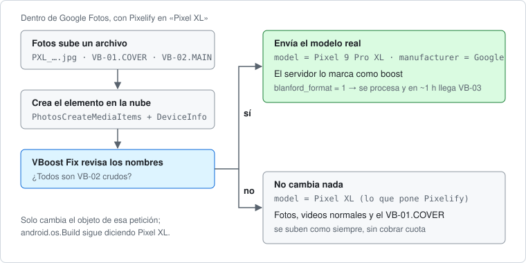

# VBoost Fix

Módulo LSPosed para que los videos con **Video Boost** de un Pixel se procesen en Google Fotos aunque [Pixelify GPhotos](https://github.com/BaltiApps/Pixelify-Google-Photos) esté activo.

Incluye también los scripts de diagnóstico (teléfono y PC) y las notas de ingeniería inversa con las que se encontró el arreglo.

## El problema

Pixelify hace que Google Fotos crea que el teléfono es un **Pixel XL** de 2016. Con ese modelo, los videos con Video Boost que se suben nunca se procesan: se quedan como el video crudo y no llega nunca la versión mejorada.

Un Video Boost son dos archivos:

| Archivo | Qué es |
|---|---|
| `PXL_<fecha>.VB-01.COVER.mp4` | Vista previa de 1080p. |
| `PXL_<fecha>.VB-02.MAIN.mp4` | Video crudo (HEVC de 10 bits, unos 240 Mbps) que se sube para procesarlo. |
| `PXL_<fecha>.VB-03.MAIN.mp4` | Resultado procesado; Fotos lo descarga y reemplaza al VB-02 (alrededor de 1 hora después). |

Las pruebas mostraron que el servidor decide si un video es un boost según el **DeviceInfo** (modelo y fabricante) que Fotos envía en la llamada `PhotosCreateMediaItems` al crear el elemento en la nube. Con «Pixel XL», el servidor registra el `VB-02.MAIN` como un video normal.

## Cómo lo arregla

El módulo engancha el constructor de la petición `PhotosCreateMediaItems` dentro de Google Fotos y revisa los nombres de archivo que lleva:

- Si **todos** son `VB-02` crudos, cambia el modelo y el fabricante de esa petición por los reales del teléfono (`ro.product.model`, `ro.product.manufacturer`).
- Si hay fotos, videos normales, un `VB-01.COVER`, un `VB-03` o un lote mixto, no cambia nada.

Solo modifica el objeto de esa llamada y no toca `android.os.Build`: el resto de Fotos sigue viendo un Pixel XL.



Por qué solo el `VB-02`: en las pruebas, subir el `VB-01.COVER` como «Pixel XL» y únicamente el `VB-02.MAIN` con el modelo real bastó para que el servidor procesara el boost, y así la vista previa no cobra cuota. Si en tu caso no se procesa, en `Hook.java` está `INCLUDE_COVER` para cambiar también la identidad del COVER.

## Requisitos

- Un Pixel con Video Boost (probado en un Pixel 9 Pro XL con Android 17).
- Root (KernelSU o Magisk) con [LSPosed](https://github.com/LSPosed/LSPosed).
- Pixelify GPhotos configurado con el dispositivo «Pixel XL».
- **Google Fotos 7.96.0.996044120** (versionCode 52514915). Los nombres de clase de Fotos están ofuscados y cambian con cada versión; con otra versión el módulo lo registra en el log y no cambia nada (ver [Otra versión de Fotos](#otra-versión-de-fotos)).

## Instalarlo

1. Descarga `VBoostFix-x.y.apk` de la página de [Releases](../../releases) e instálalo:
   ```bash
   adb install VBoostFix-0.1.apk
   ```
2. En LSPosed, activa **VBoost Fix** con alcance **Google Fotos** (viene preseleccionado).
3. Reinicia Fotos:
   ```bash
   adb shell am force-stop com.google.android.apps.photos
   ```

Deja Pixelify como está. No hace falta apagar el spoof para subir los boosts.

## Ejemplo: comprobar que funciona

```bash
adb logcat -s VBoostFix
```

Al subir una foto, la vista previa de un boost y después su video crudo, el log se ve así:

```
VBoostFix: cargado en com.google.android.apps.photos; modelo real=Pixel 9 Pro XL (Google)
VBoostFix: PhotosCreateMediaItems [PXL_20260101_120000000.jpg]: sin cambio, modelo=Pixel XL
VBoostFix: PhotosCreateMediaItems [PXL_20260101_120500000.VB-01.COVER.mp4]: sin cambio, modelo=Pixel XL (boost que no se cambia)
VBoostFix: PhotosCreateMediaItems [PXL_20260101_120500000.VB-02.MAIN.mp4]: modelo Pixel XL -> Pixel 9 Pro XL
```

Si sale `no se pudo enganchar blkg(cshs)`, tu versión de Fotos no coincide.

Para confirmarlo en la base de datos de Fotos, usa `bd/poll.sh` (ver abajo): el `VB-02.MAIN` debe aparecer en `remote_media` con `blanford_format=1` y `can_play_video=0`. Una hora después aproximadamente llega el `VB-03.MAIN`.

### Paso a paso: probar con un boost

1. Deja `adb logcat -s VBoostFix` corriendo en la PC.
2. Graba un video corto con **Video Boost** activado en la Cámara de Pixel.
3. Espera a que Fotos lo suba (o abre el video y pulsa «Crear copia de seguridad ahora»). Primero sube el COVER y luego el MAIN.
4. En el log debe aparecer `VB-02.MAIN.mp4]: modelo Pixel XL -> Pixel 9 Pro XL` (con el modelo de tu teléfono).
5. Al rato, en el visor de Fotos el video muestra que se está mejorando. Cerca de una hora después, Fotos descarga `VB-03.MAIN.mp4` y el video aparece mejorado.

### Problemas comunes

| Síntoma | Causa probable | Qué hacer |
|---|---|---|
| No sale nada con `logcat -s VBoostFix` | El módulo no está activo o Fotos no se reinició | Actívalo en LSPosed con alcance Google Fotos y haz `am force-stop com.google.android.apps.photos`. |
| `no se pudo enganchar blkg(cshs)` | Tu versión de Fotos no es la 7.96.0 | Instala esa versión o adapta `Hook.java` (ver abajo). |
| `lote mixto (...); sin cambio` | Fotos mandó el boost junto con otros archivos en la misma llamada | Sube ese video solo, con «Crear copia de seguridad ahora». |
| El MAIN sale con `blanford_format=NULL` | Se subió antes de activar el módulo | Ese ya no se procesará; prueba con un boost nuevo. |
| Hay dos líneas «cargado en …» | Tienes dos copias del módulo activas | Deja solo una activa en LSPosed. |

### Qué significa `blanford_format`

«Blanford» es el nombre interno de Video Boost en Fotos.

| Valor | Significado |
|---|---|
| `NULL` | Video normal (con el spoof sin arreglar, el servidor deja así el `VB-02`). |
| `1` | Boost crudo pendiente de procesar. |
| `2` | Boost ya procesado. |

### Costo de almacenamiento

- Las fotos, videos normales y el `VB-01.COVER` siguen subiéndose como «Pixel XL».
- El resultado procesado (`VB-03`) **sí cuenta** para la cuota de Google, con su tamaño final.

## Scripts de diagnóstico

### En el teléfono (`scripts/`)

Se copian a `/data/local/tmp` (con finales de línea LF) y se ejecutan con `sh`. Los marcados con «root» necesitan `su`.

```bash
adb push scripts/*.sh /data/local/tmp/
adb shell "sh /data/local/tmp/mq.sh"                         # MediaStore: archivos VB-0*
adb shell "su -c 'sh /data/local/tmp/pixelify.sh'"           # root: preferencias de Pixelify y si está cargado en Fotos
adb shell "su -c 'sh /data/local/tmp/findvb.sh'"             # root: busca archivos VB en el almacenamiento
adb shell "su -c 'sh /data/local/tmp/estado.sh VB-0'"        # root: uptime, alcance de LSPosed y archivos VB
adb shell "su -c 'sh /data/local/tmp/copydb.sh list'"        # root: tamaño de las bases de Fotos y Cámara
adb shell "sh /data/local/tmp/txguard.sh 25 120"             # detiene Fotos si sube más de 25 MB en 120 s
```

| Script | Qué hace |
|---|---|
| `mq.sh [control]` | Consulta MediaStore (solo lectura) de los archivos `VB-0*` y, opcionalmente, de un video de control. |
| `findvb.sh` | Busca archivos Video Boost en `/data/media/0` (root). |
| `copydb.sh list\|copy` | Lista o copia en caliente las bases y preferencias de Fotos y Cámara a `/data/local/tmp/boostdb` (root). |
| `copydb_min.sh` | Copia solo `gphotos0.db` y `media_store_extras` a `/data/local/tmp/boostdb_min` (root). |
| `pixelify.sh` | Muestra las preferencias activas de Pixelify y si el módulo está mapeado en el proceso de Fotos (root). |
| `estado.sh [patrón]` | Uptime, copia la configuración de LSPosed y lista los archivos que coinciden en `DCIM/Camera` (root). |
| `owner.sh <paquete> <id>...` | Cambia `owner_package_name` de filas de MediaStore, por ejemplo a `com.google.android.GoogleCamera` (root). |
| `txguard.sh <MB> <segundos>` | Vigila lo enviado por `wlan0` y hace `force-stop` de Fotos si se pasa del umbral. |

### En la PC (`bd/`, Git Bash + Python 3)

Usan `adb` del `PATH`, la variable `ADB` o, si no, el del SDK de Android en su ruta por defecto de Windows. Necesitan `copydb_min.sh` en `/data/local/tmp` del teléfono.

```bash
export MSYS_NO_PATHCONV=1                                     # en Git Bash, para que no reescriba /data/local/tmp
adb devices                                                   # serial del teléfono (por Wi-Fi es ip:puerto)

bash bd/poll.sh <serial> '%VB-0%'                             # snapshot de las bases en bd/poll_ultimo y estado
python bd/estado_boost.py bd/poll_ultimo '%PXL_20260101%'     # estado de un snapshot ya copiado
bash bd/esperar_vb.sh <serial> 40                             # espera a que aparezca un VB-02.MAIN nuevo
bash bd/esperar_vb03.sh <serial> PXL_20260101_120500000 150   # espera el VB-03 de una grabación
bash bd/esperar_vb03_varios.sh <serial> 150 <base1> <base2>   # lo mismo para varias grabaciones
```

Salida de `estado_boost.py` (recortada):

```
== remote_media (2)
  filename=PXL_20260101_120500000.VB-01.COVER.mp4  blanford_format=None  can_play_video=1  quota_charged_bytes=0  ...
  filename=PXL_20260101_120500000.VB-02.MAIN.mp4  blanford_format=1  can_play_video=0  quota_charged_bytes=0  ...
```

Los snapshots contienen datos personales de tu biblioteca de Fotos: el `.gitignore` los deja fuera del repositorio.

## Compilar

No usa Gradle: `VBoostFixApp/build.ps1` llama directamente a `aapt2`, `javac`, `d8`, `zipalign` y `apksigner`. La API de Xposed 82 se descarga sola de `api.xposed.info` la primera vez (solo se usa para compilar, no va dentro del APK).

Requisitos: Android SDK con `platforms/android-36` y `build-tools/37.0.0`, y un JDK (por defecto el `jbr` de Android Studio).

```powershell
.\VBoostFixApp\build.ps1
# APK listo: VBoostFixApp\build\VBoostFix.apk
```

Se pueden cambiar las rutas con `ANDROID_HOME`, `BUILD_TOOLS` y `JAVA_HOME`. La primera vez crea una clave de firma local que no se sube al repositorio.

## Otra versión de Fotos

Los nombres usados en `Hook.java` (`blkg`, `cshs`, y los campos `c`, `e`, `k`, `d`) solo valen para Fotos 7.96.0. Para otra versión:

1. Saca el APK (`adb shell pm path com.google.android.apps.photos`) y descompílalo con [jadx](https://github.com/skylot/jadx).
2. Busca la clase que contiene la cadena `"MediaItemCreator"` y la que construye la petición `PhotosCreateMediaItems`; el DeviceInfo se reconoce por usar `Build.SERIAL`, `Build.MODEL` y `Build.MANUFACTURER` en un mismo método.
3. Actualiza las constantes de `Hook.java`.

El análisis completo está en [ingenieria_inversa_fotos_7.96.md](ingenieria_inversa_fotos_7.96.md).

## Aviso

Pixelify cambia la identidad del teléfono ante Google Fotos; usarlo puede ir contra los términos de servicio de Google. Este módulo solo hace que el teléfono envíe su modelo real en las subidas de Video Boost. Úsalo bajo tu responsabilidad. No está afiliado a Google ni a Pixelify.

## Licencia

[MIT](LICENSE). Pixelify GPhotos es © BaltiApps, también MIT, y no se incluye en este repositorio.
